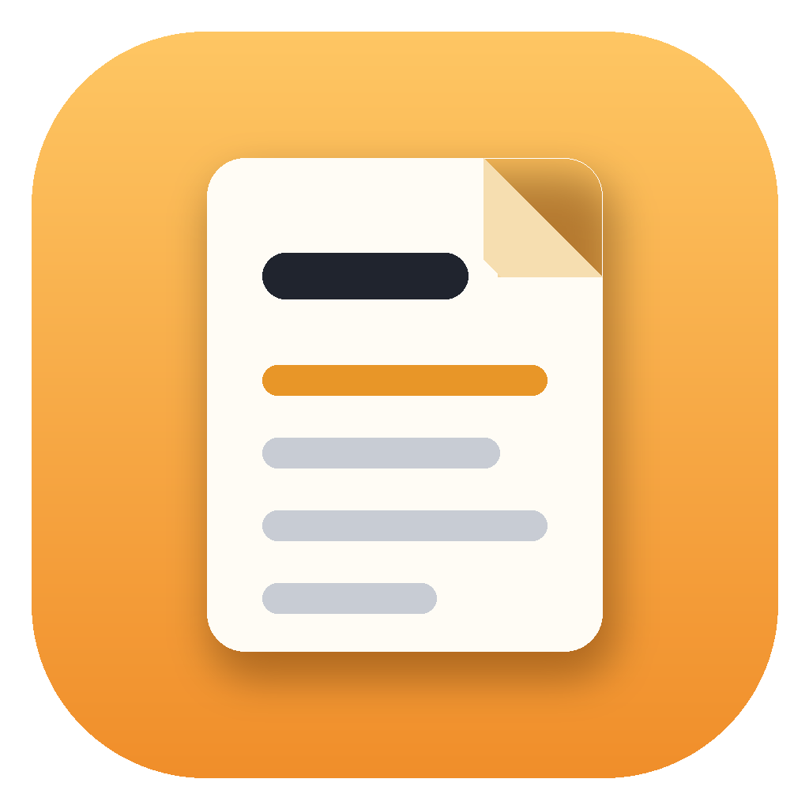
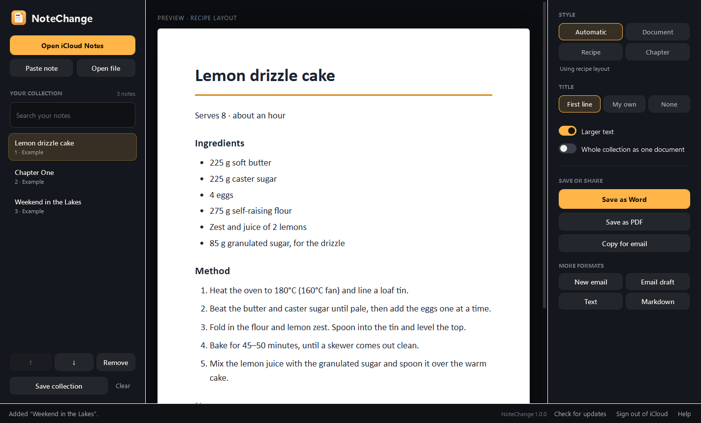
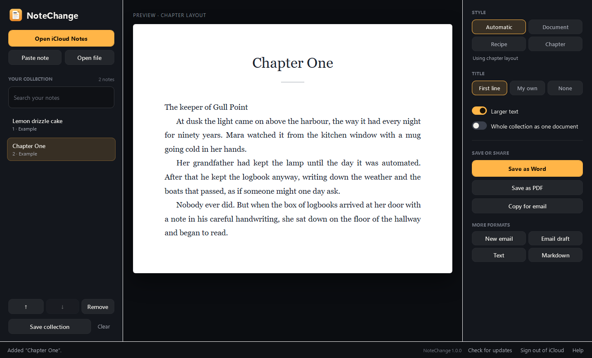
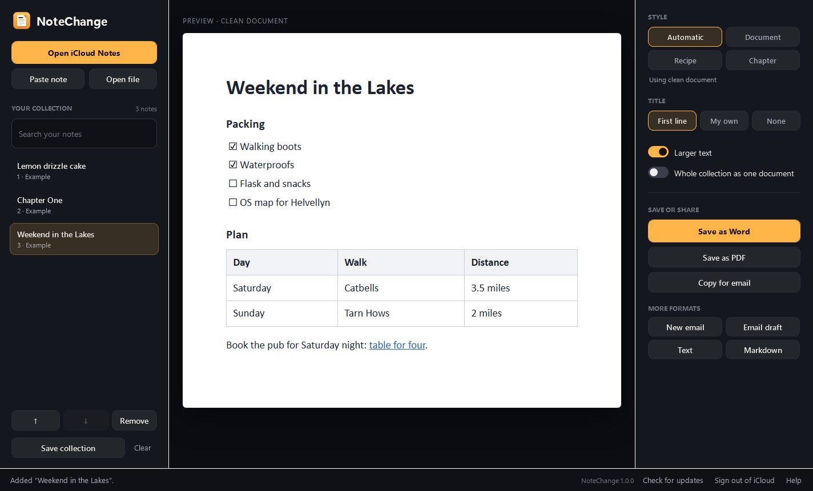

<div align="center">



# NoteChange

**Your notes, ready to share.**

Turn iCloud notes into Word documents, PDFs and emails for Windows. Recipes get proper Ingredients and Method headings,
stories get book typography, and everything else gets a clean, simple layout. Every word stays exactly as you wrote it.

**[Download NoteChange for Windows](https://github.com/bhxuk/notechange/releases/latest/download/NoteChange-Setup.exe)**  ·  [Website](https://bhxuk.github.io/notechange/)  ·  [User guide](docs/USER-GUIDE.md)  ·  [What's new](CHANGELOG.md)



</div>

---

## What it does

| | |
|---|---|
| **Brings notes across from iCloud** | Sign in on Apple's own iCloud page inside NoteChange, open a note and press **Add this note**. Add as many as you like to build a collection. |
| **Lays them out for you** | **Automatic** picks a style. **Recipe** turns Ingredients, Method and Notes into headings. **Chapter** uses serif type and indented paragraphs. **Document** keeps it clean. |
| **Keeps your words** | Nothing is rewritten, summarised or reordered. Bold, italics, underlines, links, lists, checklists, simple tables and pictures come across. |
| **Saves the way you need** | Word (.docx), PDF (A4), a ready-to-send email draft (.eml), Copy for email, plain text and Markdown. |
| **Handles collections** | Put notes in order and export them as one document, each starting on a new page. Save the collection and open it again later. |
| **Stays on your PC** | No account, no cloud conversion, no AI. Your Apple sign-in is handled by Apple and kept in NoteChange's own browser on this PC. |

You can also paste a note from anywhere, open `.txt`, `.md` and `.html` files, or drag them onto the window.

## Install

1. Download **[NoteChange-Setup.exe](https://github.com/bhxuk/notechange/releases/latest/download/NoteChange-Setup.exe)**.
2. Double-click it. No admin rights needed; it installs just for you.
3. Windows may say **"Windows protected your PC"** because the installer isn't code-signed. Click **More info**, then **Run anyway**.

NoteChange runs on Windows 10 (1809 or later) and Windows 11, 64-bit. It uses the Microsoft Edge WebView2 Runtime, which is already on Windows 11 and almost every Windows 10 PC; Setup tells you if it's missing.
NoteChange checks for updates and installs them with one click.

## A quick tour

### Book chapters



### Checklists and tables



## Good to know

- Notes must be in iCloud. Notes kept only "On My iPhone" don't appear on iCloud.com, so copy them and use **Paste note**.
- Locked notes need unlocking in iCloud first.
- Attachments other than pictures (PDFs, audio, sketches) stay in Apple Notes.
- Reading iCloud Notes works through Apple's web page, not an official Apple API. If Apple changes that page, NoteChange may need an update; **Paste note** always works.

## Build it yourself

You need the [.NET 8 SDK](https://dotnet.microsoft.com/download/dotnet/8.0) on Windows.

```powershell
dotnet test tests/NoteChange.Tests
dotnet run --project src/NoteChange
```

Make the single-file app and check it end to end:

```powershell
dotnet publish src/NoteChange -c Release -r win-x64 --self-contained -p:PublishSingleFile=true -p:IncludeNativeLibrariesForSelfExtract=true -o publish
publish\NoteChange.exe --self-test "$env:TEMP\notechange-test"
```

The self-test opens the real window, renders every example, writes Word, PDF, email, text and Markdown files, and reads a note from a stand-in iCloud page.
`installer/NoteChange.iss` builds `NoteChange-Setup.exe` with [Inno Setup 6](https://jrsoftware.org/isinfo.php).

Every push to `main` is built and tested on Windows by GitHub Actions. When the version in `src/NoteChange/NoteChange.csproj` changes, a new release with `NoteChange-Setup.exe` is published automatically.

### Project layout

| Folder | What's in it |
|---|---|
| `src/NoteChange.Core` | Reading notes, layouts and every export format. No Windows code, so it's fully unit-tested. |
| `src/NoteChange` | The Windows app: main window, iCloud window, preview, PDF printing and updates. |
| `tests` | Conversion tests, including checking the Word output against the Open XML schema. |
| `installer` | The Inno Setup script. |
| `docs` | The website, user guide and privacy notes. |

## Privacy

See [docs/PRIVACY.md](docs/PRIVACY.md). In short: NoteChange has no servers. It talks to iCloud (to show your notes) and to GitHub (to check for updates), and nothing else.

---

MIT licensed. Apple, iCloud and Apple Notes are trademarks of Apple Inc. NoteChange is an independent app and isn't made or endorsed by Apple.
